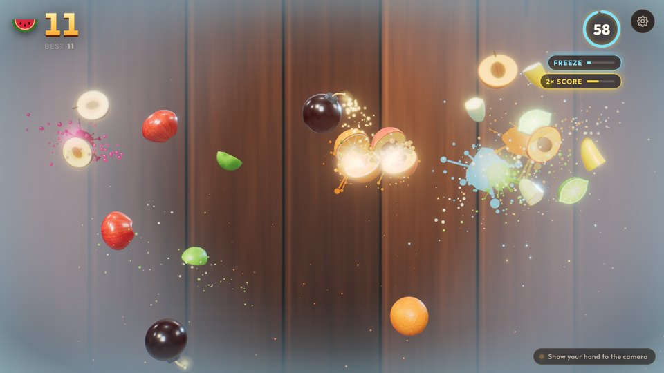
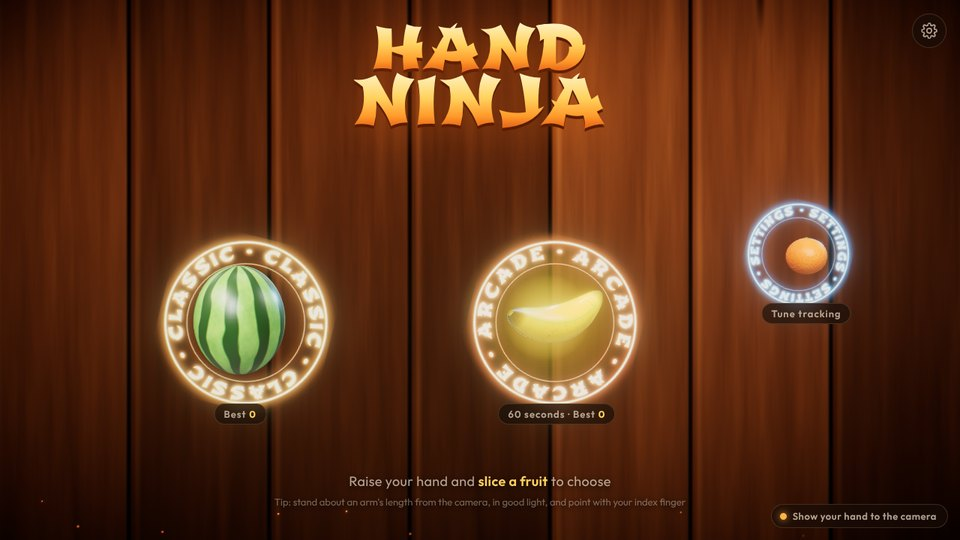
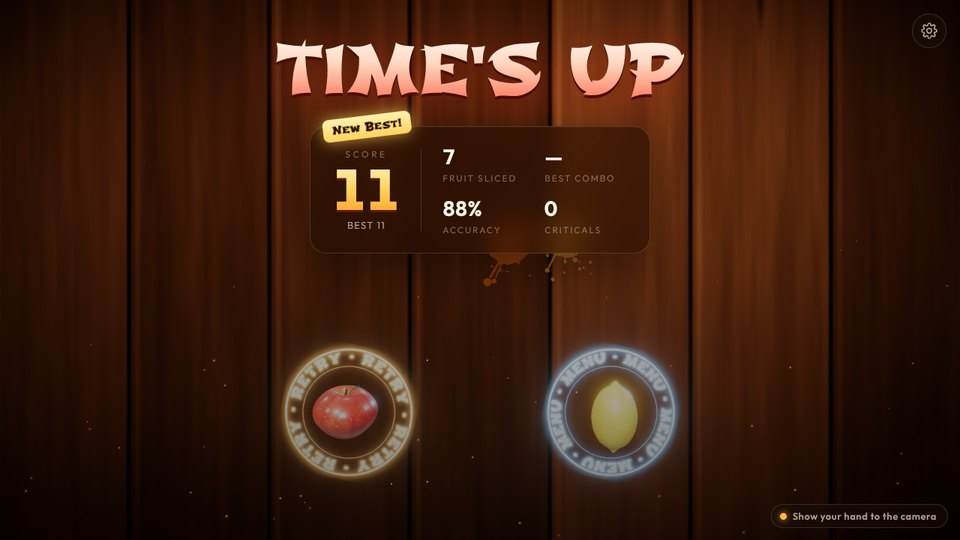

# Hand Ninja

A Fruit Ninja-style browser game where **your hand is the blade**. Your webcam tracks your index fingertip with MediaPipe, and every fruit, effect, sound and piece of music is generated procedurally. The game ships no image or audio files.



| Title | Results |
| --- | --- |
|  |  |

## Run it

```bash
npm install      # also copies the MediaPipe WASM runtime into public/
npm run dev      # http://localhost:5173
```

Open the page in Chrome or Edge (Safari and Firefox work too), click **Enter the Dojo** and allow camera access. Hold up your hand and slice a fruit to pick a mode.

- The camera only works on `localhost` or over `https`. To play from a phone on your network, serve it over https (for example with `npx vite --https` and a plugin, or a tunnel).
- No camera? Click-and-drag (or touch-drag) with the mouse works everywhere.
- `npm run build` produces a static site in `dist/` that you can host anywhere.

## Deploy (Vercel)

The repo is ready for [Vercel](https://vercel.com) (`vercel.json` sets the build, output and caching).

1. Sign in at [vercel.com](https://vercel.com) with GitHub and choose **Add New… → Project**.
2. Import `hand-ninja`. If it isn't listed, use **Adjust GitHub App Permissions** to give Vercel access to the repo.
3. Keep the detected settings (Vite, `npm run build`, output `dist`) and click **Deploy**.

You get an HTTPS URL like `https://hand-ninja.vercel.app`, so the camera works on laptops and phones. Every push to `main` redeploys, and other branches get preview URLs.

From a terminal instead: `npx vercel` (preview) or `npx vercel --prod`.

## Game modes

- **Classic:** endless and gets harder over time. Miss 3 fruit or hit 1 bomb and the game is over.
- **Arcade:** 60 seconds. Bombs cost 10 points. Glowing bananas give power-ups: **Freeze** (slow motion, timer paused), **Frenzy** (fruit thrown in from both sides) and **Double Score**.

Both modes have combos (3+ fruit in one swipe), random **Critical** hits on fast swipes, and a best score saved per mode.

## How the hand tracking works

```
Webcam (30–60 Hz) ─► Web Worker: MediaPipe HandLandmarker (CPU/GPU) ─► index-finger point (landmarks 6–8)
   ─► mirror + cover-fit + "reach" zoom (same transform as the background video)
   ─► One Euro filter ─► velocity estimate ─► extrapolate to render time (+lead)
   ─► Blade (60–120 Hz) ─► swept segment-vs-circle slicing
```

- **CPU or GPU, chosen per device:** in the worker, MediaPipe is benchmarked on the CPU (XNNPACK) and, if that's slow, on the GPU. The CPU is preferred whenever it keeps up, because the GPU is busy rendering the game and sharing it causes frame hitches.
- **Light camera mode:** the webcam is requested at 640×360 and up to 60 fps. MediaPipe never uses more than ~224 px crops, and lower modes give webcams higher frame rates, which means lower latency.
- **Off the main thread:** each new camera frame is captured as a downscaled `ImageBitmap` and transferred to a Web Worker that runs MediaPipe, with one frame in flight at a time (no backlog of stale frames). Rendering never waits for inference, so a slow detection costs tracking rate, not frame rate. If module workers or `OffscreenCanvas` aren't available, it falls back to running on the main thread automatically. The model is warmed up during the loading screen, so the first real frame isn't slow.
- **Latency-aware timing:** results are stamped with the frame's *capture* time, which drives filtering and prediction, so inference latency is compensated. *Arrival* time drives "is the hand still there", with a timeout that adapts to the measured detection rate.
- **Smoothing without lag:** a 2D [One Euro filter](https://gery.casiez.net/1euro/) adapts its cutoff to speed, so a resting hand is steady and a fast swipe passes through almost unfiltered.
- **Camera rate ≠ screen rate:** detection runs once per camera frame. While the hand is clearly moving, the blade is extrapolated from the filtered velocity to each render frame (capped at 50 ms to avoid overshoot), and light output smoothing hides the camera's frame steps. A resting hand is never extrapolated, so it doesn't jitter.
- **Steady blade point:** the default blade point is a weighted blend of the last three index-finger joints. It sits close to the fingertip but is far steadier than the tip landmark, which jitters most and jumps when the finger blurs.
- **No tunnelling:** fruit is tested against the segment the blade travelled this frame, not a single point, so fast swipes never pass through a fruit. Pointer input keeps every sample between frames for the same reason.
- **Deliberate cuts only:** the blade becomes "live" only above a minimum speed (with hysteresis), so a hand hovering near a fruit doesn't slice it.
- **Exact alignment:** the camera background and the landmark mapping share one mirror + cover-fit + zoom transform, so the glowing blade tip sits on your real fingertip.
- **Robustness:** brief tracking dropouts (motion blur) are bridged. Large jumps are treated as glitches and don't cut. Losing your hand for more than 1.2 s pauses the game.

### Tips for the best tracking

- **Light matters most.** In dim rooms webcams lengthen exposure and drop to ~15 fps, which feels laggy and blurs fast swipes. The status chip says "more light helps" when the camera is the bottleneck.
- Stand about an arm's length back so your whole hand is in view, and swipe in the middle of the frame.
- If the blade feels jittery, choose **Palm center** in Settings. If it lags, raise **Responsiveness**.

### Troubleshooting

- Press `D` for the performance overlay: render fps and resolution, tracking fps and inference time, the CPU/GPU benchmark, and the camera mode.
- Add `?delegate=gpu` or `?delegate=cpu` to force MediaPipe onto one processor (the default `auto` benchmarks both).
- Add `?thread=main` to run tracking on the main thread instead of a worker.

Everything above can be tuned live in **Settings**: blade sensitivity, reach, steadiness/responsiveness (One Euro parameters), prediction, and which landmark drives the blade (index tip, middle tip or palm center).

## How the fruit is made

Each fruit is a lathe (surface of revolution) built from a 2D profile, with skins painted procedurally on canvases (stripes, pores, blush, seeds). Slicing a lathe through its axis is exact and cheap. Each half is a half-lathe plus a flat cap shaped like the profile, textured with the fruit's flesh (seeds, segments, pits). At the moment of the cut, the fruit is rotated by the smallest rotation that lines the cut plane up with your swipe, so it always splits the way you cut it. Each half then spins about the swipe axis so its flesh turns towards you.

## Performance

- **Adaptive resolution:** a governor watches the real frame rate and steps resolution (and MSAA) down until the game holds ~60 fps, and back up when there's headroom. It never returns to a level that has proven too slow, so it doesn't oscillate.
- **One post-processing pass:** bloom, chromatic aberration, vignette and tone mapping share a single full-screen pass. The shock-wave pass only runs for the second after a bomb.
- **Baked background:** the procedural wood wall is rendered once into a texture on resize. Each frame only samples it and the camera.
- **No mid-game shader compiles:** every material is compiled for the real HDR render target during loading, so the first fruit, bomb or power-up never stutters.
- **Cheap UI:** no live backdrop blurs over the canvas, the camera preview only redraws on tracking updates, and particle buffers upload only their live range.

## Effects and audio

- HDR rendering with bloom, ACES tone mapping, vignette, chromatic aberration and a shock-wave distortion on bomb hits ([postprocessing](https://github.com/pmndrs/postprocessing))
- Glowing, tapered, Catmull-Rom-smoothed blade trail, juice droplets with specular highlights, mist, sparks, juice stains on the dojo wall, drifting embers
- Hit-stop on every slice, slow motion on big combos and bombs, trauma-based screen shake
- Web Audio synthesis: speed-dependent swipe whooshes, wet splats, metallic "shing", bomb fuse crackle and explosion, combo arpeggios, and a generative koto + taiko soundtrack in the Japanese *In* scale

## Project layout

```
src/
  App.ts                 state machine, frame loop, input wiring
  tracking/              HandTracker (MediaPipe), OneEuroFilter, video↔screen mapping
  input/Blade.ts         blade model: filtering, prediction, live state, swept hit tests
  game/                  Game rules/spawner, World (slice physics + FX), Menu (slice-to-select rings), procedural fruitModels
  render/                Renderer + post FX, Background shader, BladeTrail, Particles, Splatters, textures
  audio/AudioEngine.ts   procedural SFX + music
  ui/                    DOM HUD/screens/settings, floating popups
public/models/           MediaPipe hand_landmarker.task (Apache-2.0)
```

## Tech

Vite · TypeScript · Three.js · postprocessing · MediaPipe Tasks Vision · GSAP · Fontsource (Shojumaru, Outfit)
